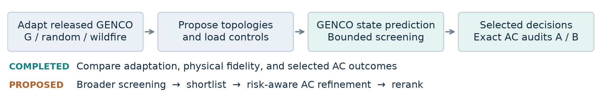
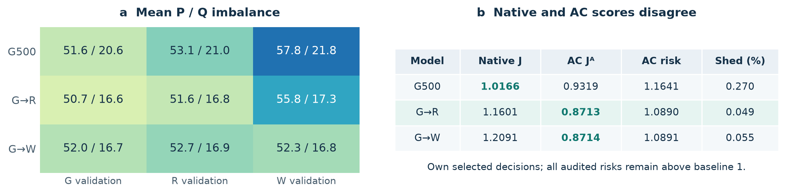
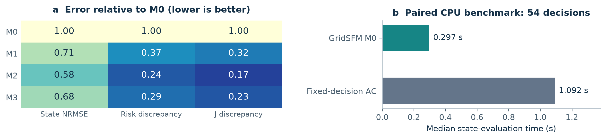

# GENCO in the Loop

**Grid-to-task adaptation and physical verification for wildfire-aware power shutoff**  
**Caleb Lu and Xiao Liu** · H. Milton Stewart School of Industrial and Systems Engineering, Georgia Institute of Technology  
Contact: [clu360@gatech.edu](mailto:clu360@gatech.edu) (primary); [xiao.liu@isye.gatech.edu](mailto:xiao.liu@isye.gatech.edu)

## Summary

How does adapting a grid foundation model change the quality of decisions made with it? We use **GENCO-OPF** as a downstream testbed for wildfire-aware optimal power shutoff (OPS), connecting prediction fidelity, topology screening, and exact AC verification. On one modified Texas2k case, 500-example adaptations yield audited normalized risks of **1.164, 1.089, and 1.089**, all above the stored baseline. **G500 looks best under native scoring, while contingency-adapted checkpoints look best after AC recovery.** A GridSFM/GOC-500 precursor provides context. The central finding is that task-specific adaptation changes selected decisions but guarantees neither physical feasibility nor consistently better operating outcomes.

## Motivation and method

OPS trades reduced wildfire exposure against interrupted service [1]. Repeated state evaluations make a reusable predictor attractive. GENCO's GraphKit implementation [2] lets us adapt a checkpoint and evaluate changed topology and demand. Its OPF interface predicts dispatch; our wrapper does not expose arbitrary generator commands or condition the model directly on a wildfire objective.

For energized-line indicators **z** and served-demand fractions **α**, we report **J = λR Rnorm + (1 − λR) Lshed**. Rnorm sums environmental exposure × squared apparent-power loading over energized transmission risk lines, divided by stored intact-grid risk; Lshed is the unserved demand fraction. This is an exposure proxy, not a calibrated ignition probability. GENCO's Phase I search minimizes J; physics violations are separate diagnostics.

*Figure 1. Completed work adapts GENCO, screens bounded topology/service choices, and audits selected decisions. Broader screening followed by risk-aware AC refinement and reranking is the proposed extension.*

Both studies permit at most two shutoffs and search five load-service controls with at most 20 evaluations per topology. **Reference A** fixes topology and service, then minimizes AC generation cost. **B1/B2** maximize total service, then minimize cost at that service under a documented recovery policy; B does not constrain wildfire risk. These are local solver outcomes, not global certificates. Full formulations and generator bounds are in the [methodology](https://github.com/clu360/GENCO-Challenge-Optimal-Power-Shutoff/blob/main/docs/methodology.md).

<!-- pagebreak -->

## GENCO on Texas2k: what task adaptation changes

We study target-grid adaptation under geographic wildfire exposure: one frozen operating case, load Scenario 16, and the June 23, 2023, 16:00 CDT weather-hazard snapshot. The modified synthetic system has 2,751 buses and 5,344 branches. It differs from the official GENCO Texas grid; this is not utility operational validation or demonstrated cross-region transfer.

**Matched adaptation and search budgets.** G500 uses 500 intact-grid examples; G→R/W use 100 intact followed by 400 random/wildfire-ranked outage examples. W samples outages, not optimal OPS labels. Each search evaluates 301 topologies and 6,020 objective calls: intact, 50 common single outages, and 250 evaluator-dependent pairs. This compares adaptation strategies, not improvement over the released checkpoint.

*Figure 2. Left: mean bus-level absolute P/Q imbalance on 100 cases per distribution (MW/MVAr; color denotes P). Right: each checkpoint's own selected decision, scored natively and after Reference A at λR = 0.8; lower J is better. G→R/W open pair 117;281; G500 opens 117;1548 (local branch indices).*

**Average fidelity and extremes tell different stories.** On G validation, mean P imbalance is similar across final checkpoints (51–52 MW). Sequential adaptation lowers mean Q imbalance from 20.6 to about 16.6–16.7 MVAr. On wildfire validation, G→W has the lowest mean P imbalance (52.3 versus 55.8 and 57.8 MW). However, mean worst-bus P imbalance on G validation increases from **6,265 MW** for G500 to **9,312/9,841 MW** for G→R/W. These predictions must not be treated as AC-feasible states.

**AC auditing reverses G500's native-score advantage.** Across the three selected decisions, native J favors G500 (1.0166 versus 1.1601/1.2091), while Reference A J favors G→R/W (0.8713/0.8714 versus 0.9319), about 6.5% lower. Each model explores its own K2 pool, and AC recovery replaces predicted dispatch; this is a change in cross-model finalist ordering, not common-pool ranking agreement or a causal adaptation effect. R/W share a pair and nearly identical outcomes. All audited risks exceed baseline 1; economic redispatch against stored loading does not isolate the effect of shutoffs.

**Continuous recourse exposes a distinct tradeoff.** Historical DC/AC searches reach audited risk 0.488/0.474 while shedding 43.76%/34.61%; B restores essentially full service at risk 1.100/1.084. GENCO's B risks are 1.172 (G500) and 1.096 (G→R/W), also at full service. Maximum service therefore does not preserve lower risk. The historical optimizers freely adjust dispatch and service; their gap from GENCO mixes control freedom, fidelity, and search coverage. Eight Texas fits are certified; native GridSFM OPS/AC remains pending in this evidence cut.

<!-- pagebreak -->

## GOC-500 precursor: fidelity gains exceed decision gains

The precursor uses **GridSFM, not GENCO** [3], on three constructed hazard patterns, five λR values, and 100 topology attempts from shared frozen pools per setting. Released M0 is compared with M1 (1,000 intact examples), M2 (M1 + 500 intact), and M3 (M1 + 500 N−1). A common test population contains 375 intact and 375 N−1 cases. M2 has the lowest intact-case loss; M3 has the lowest N−1 loss. Intact branch-P MAE falls from 0.0745 p.u. (M0) to 0.0350 (M2).

*Figure 3. Left: mean state-family NRMSE and absolute native-to-A risk/objective discrepancies at each model's own selected decisions across 15 common settings, divided by the corresponding M0 value. Lower means less error, not a feasibility rate. Right: a separate 54-decision CPU benchmark of released M0; displayed medians are not the paired speedup estimator.*

M2 reduces state NRMSE by 42% and risk discrepancy by 76%, yet mean AC-audited J improves only about 1.1% versus M0; M1 has the best mean audited J. At λR = 0.8, M1's audited risks are 0.394, 0.945, and 0.448 with about 0.93% shedding, already close to M0. Prediction improvements therefore need not yield comparable decision improvements. Constructed GOC hazards and geographic Texas exposure also have different risk concentration; their reduction magnitudes are not directly comparable.

The paired CPU benchmark finds **3.59× median speedup** for complete M0 state evaluation versus fixed-decision AC-OPF (95% bootstrap interval 3.48–3.68). Startup, downstream scoring, and publication I/O are excluded. A separate 525-solve warm-start study finds only 2.2% lower mean IPOPT time for M2, excluding inference. Neither measurement establishes GENCO/Texas end-to-end acceleration.

## Lessons, next steps, and reproducibility

The contribution is a testbed that exposes the interaction between **adaptation distribution, physical fidelity, control interface, and audited decision quality**. We propose broader, shallow topology screening followed by risk-aware AC refinement of a shortlist. Future tests will measure top-N recall, rank agreement, audited objective gaps, and total runtime under matched control budgets. Increasing the shutoff budget and increasing candidate coverage are separate experiments; this extension is not yet implemented.

The repository provides 15 selectable checkpoint entries, retained result tables, four notebooks, and a small public IEEE-14 **GENCO compatibility demo**. That demo establishes a runnable loading/evaluation path, not reproduction of Texas performance. All three figures and this PDF rebuild from included compact tables without private inputs or PACE. Exact modified Texas electrical inputs remain private; public weather-derived exposure is included. The exact GOC test-population hashes and official acquisition recipe are provided, but its full 750-case replay has not been reverified. Full historical OPS/AC recomputation remains a separate task.

**Resources.** [Public code, notebooks, results, and data coverage](https://github.com/clu360/GENCO-Challenge-Optimal-Power-Shutoff) · [Public checkpoint archives](https://github.com/clu360/GENCO-Challenge-Optimal-Power-Shutoff/releases/tag/phase-i-models-v152) · [GOC technical supplement](supplementary/GOC500_technical_report.pdf). Repository and model-download access are verified without authentication; exact Texas electrical inputs remain private. The accompanying availability note supersedes the supplement's earlier “upon acceptance” statement.

**References.** [1] [Rhodes, Ntaimo & Roald, *Balancing Wildfire Risk and Power Outages Through Optimized Power Shut-Offs*, 2021](https://doi.org/10.1109/TPWRS.2020.3046796). [2] [Puech et al., *GENCO*, 2026](https://arxiv.org/abs/2608.09921) and [OpenGridFM GraphKit](https://github.com/gridfm/gridfm-graphkit). [3] [Yang et al., *GridSFM: A Foundation Model for AC Optimal Power Flow*, 2026](https://www.microsoft.com/en-us/research/publication/gridsfm-a-foundation-model-for-ac-optimal-power-flow/).
